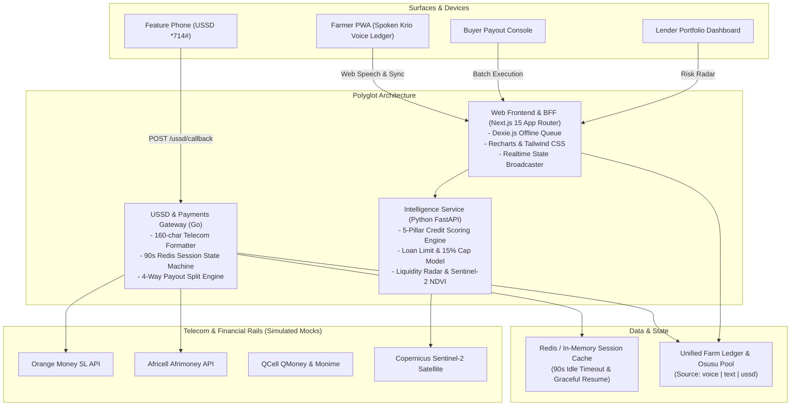

# Fambul Fund (Salone Agri-Osusu Credit & Repayment Infrastructure)

> **Event:** Sierra Leone Fintech Innovation Challenge 2026 (UNCDF + Muzambiringa, Salone Access to Finance)  
> **Product:** Agri-fintech platform converting informal rotating savings (Osusu) groups into bankable agricultural cooperative units with repayment-at-source.

---

## ⚡ Quickstart (Setup in Under 5 Commands)

```bash
# 1. Clone repository
git clone https://github.com/fambulfund/fambul-fund.git && cd fambul-fund

# 2. Setup environment variables
cp .env.example .env

# 3. Run complete polyglot test suite (Vitest + Pytest + Go test)
make test

# 4. Start Next.js fullstack application
cd web && npm run dev

# 5. Open http://localhost:3000 in your browser!
```

*Alternatively, run all polyglot microservices with Docker:*
```bash
docker compose up --build
```

---

## 🏛️ Architecture & Polyglot Stack Diagram



---

## 🎨 Design System & Monime-Inspired UI Architecture

The user interface follows the high-contrast modern African fintech design language of **[Monime](https://monime.io/)**:
- **Palette:** Monime Electric Blue (`#0180FF`), Obsidian Navy (`#0B132B`), Crisp Slate neutrals, and fresh Emerald (`#10B981`) cashflow indicators.
- **Spacious High-Profile Header:** `h-20` generous vertical spacing, Bank of Sierra Leone sandbox compliance badge, interactive role navigation, bilingual Krio/EN switcher, offline simulation toggle, and interactive **"Log in"** button.
- **Authentication & Login Functionality:** Interactive multi-persona Login Modal supporting 1-click test credentials for Farmers, Aggregator Buyers, Bank Credit Officers, and Challenge Regulators, with salted PIN security and authenticated session state.
- **Rich Humanized Photography:** Authentic Sierra Leone cocoa/rice smallholder and community imagery across all landing page and PWA surfaces.
- **100% Vector SVG Icons:** All visual icons are rendered with high-precision inline SVGs (`Icons.tsx`), including custom Fambul Fund coin mark and mobile money provider vector badges.
- **Interactive Financial Engine:** Live repayment-at-source harvest split simulator directly on the extended landing page.

---

## 📸 Deliverables & Evaluation Artefacts

All submission artefacts are located in [`deliverables/`](deliverables/):
- **8 High-Resolution Screenshots:** [`deliverables/SCREENSHOTS.md`](deliverables/SCREENSHOTS.md) and PNGs `screenshot-01` to `screenshot-08`.
- **90-Second Screencast Script:** [`deliverables/SCREENCAST_SCRIPT.md`](deliverables/SCREENCAST_SCRIPT.md).
- **One-Page Solution Overview & Stage Artefacts:** [`deliverables/SOLUTION_OVERVIEW_AND_STAGE_ARTEFACTS.md`](deliverables/SOLUTION_OVERVIEW_AND_STAGE_ARTEFACTS.md).

---

## 📊 Config-Driven Transparent Credit Scoring Model (v0)

Our credit scoring model is deterministic, audited, and strictly configured in `scoring.config.ts` and `scoring_config.py`:

$$\text{Group Score} = 0.35 \cdot C + 0.25 \cdot R + 0.20 \cdot S + 0.10 \cdot T + 0.10 \cdot L$$

Where:
1. **$C$ (35%) — Contribution Consistency:** On-time cycle settlement rate over the past 6 rotating Osusu cycles.
2. **$R$ (25%) — Repayment History:** Track record of repaying in-group advances and external bank/MFI credit facilities.
3. **$S$ (20%) — Buyer-Verified Sales:** Aggregator-certified receipt stability across cocoa, rice, and oil palm harvests.
4. **$T$ (10%) — Group Tenure & Size:** Operational age and member retention rate of the Osusu cooperative.
5. **$L$ (10%) — Ledger Completeness:** Frequency of farm records entered per member per month via USSD or Voice Ledger.

### Statutory Interest Rate Ceiling
In compliance with Sierra Leone rural finance regulations, the annual interest rate is strictly capped at **15.0%**. Prime groups (Tier A, score ≥ 80) unlock interest rates down to **11.5%** with 6-month seasonal tenor.

---

## 🚀 5 Flagship Innovation Differentiators

- **G1. Pot Advance (Flagship):** Smallholders can request early access to the rotating Osusu pot prior to their scheduled turn date, co-guaranteed by group consent and auto-deducted at harvest.
- **G2. Payout-Day Liquidity Radar:** Forecasts rural mobile money agent physical cash float shortfalls (e.g. Pendembu, Bo, Kailahun) on harvest payout days, triggering automatic liquidity replenishment alerts.
- **G3. Farmgate Price Index:** Transparent, anonymized price benchmarks aggregated from verified Voice Ledger and buyer payouts to protect smallholders from exploitative middlemen.
- **G4. Plot Proof:** Remote vegetation health verification using Copernicus Sentinel-2 multispectral NDVI imagery to validate farm existence without expensive field visits.
- **G5. Wallet Envelopes & Season Calendar:** Virtual sub-wallets ring-fencing funds for Agricultural Inputs, School Fees, and Emergency Reserves, synchronized with the 12-month Sierra Leone agro-calendar.

---

## 🔌 How Real Mobile Money APIs Plug In

All telecom integrations implement clean adapter interfaces (`WalletAdapter`). In production, replace the mock endpoints with the official carrier credentials:

1. **Orange Money Sierra Leone (B2C / C2B):**
   - API Endpoint: `POST https://api.orange.com/orange-money-webpay/sl/v1/transaction`
   - Headers: `Authorization: Bearer <access_token>`, `X-Country: SLE`, `X-Currency: SLE`
   - Payload: `{"recipient": "+23276XXXXXX", "amount": 838.00, "reference": "ROK-8921"}`
2. **Africell Afrimoney Sierra Leone:**
   - API Endpoint: `POST https://afrimoney.africell.sl/api/v2/disbursement`
   - Headers: `X-Api-Key: <afrimoney_key>`, `X-Signature: HMAC-SHA256`
3. **QCell QMoney & Monime Aggregator:**
   - Swappable via `payments/wallet_adapter.go` and `web/app/api/payout/route.ts`.

---

## 🛡️ Honesty, Guardrails & Data Protection

- **Simulated Financial Movement:** All transactions and money movements are simulated within a secure sandbox environment. No actual banking credentials or funds are moved.
- **Synthetic Data Disclaimer:** All Osusu group names, farmer profiles, and coordinates are synthetic representations created for demonstration. No real personal identities are exposed.
- **Human-in-the-Loop AI Guardrail:** Every AI-transcribed voice ledger record requires explicit farmer confirmation before impacting any financial ledger or credit score.
- **Privacy & Ownership:** Smallholders own their farm data and retain the right to export or delete records.
